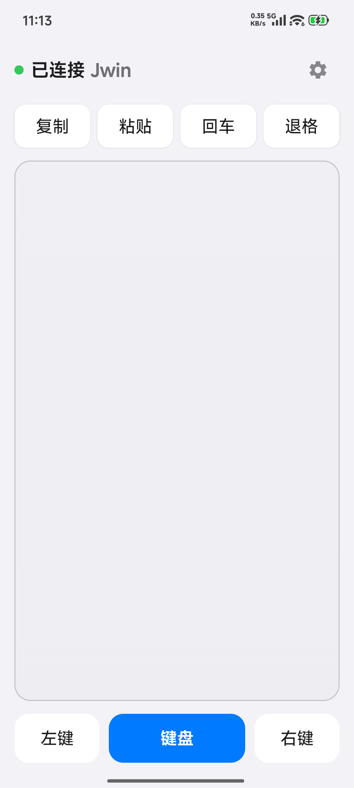
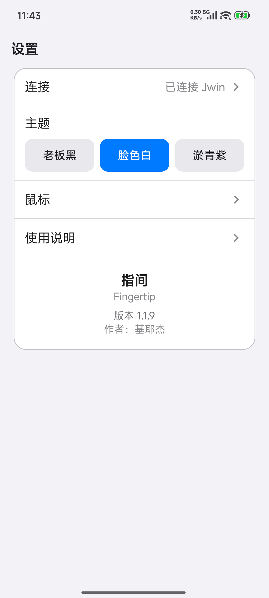

# 指间 Fingertip

把 Android 手机变成 Windows 电脑的 **无线鼠标 + 语音输入法**。

市面上的同类工具并不少，但真用起来总差一口气：要么核心功能收费，用得不痛快；要么功能越堆越杂，反而不够纯粹；要么界面毫无审美可言。既然如此，不如照自己的想法做一个——只留真正高频的能力，界面干净利落，连接简单直接。于是有了「指间」：免费、纯粹、好看，把手机变成你电脑的第二块触控板。

> 默认端口 **8765**，被占用时自动 +1。手机端支持「发现设备」自动搜索电脑，无需手动配 IP。

## 预览

<table>
  <tr>
    <td></td>
    <td></td>
  </tr>
  <tr>
    <td align="center">主界面 · 触控板</td>
    <td align="center">设置 · 主题切换</td>
  </tr>
</table>

## 功能特性

- **无线触控板**：单指移动/左键、轻点、双指滚轮、双指轻点右键、长按拖拽（震动反馈）
- **键盘直注上屏**：手机键盘输入/语音输入，增量同步后由电脑端 SendInput Unicode 直注，支持任意应用输入框
- **自动发现**：mDNS + UDP 广播 + 单播 probe 三通道，局域网内自动发现电脑，无需配对码
- **三套主题**：老板黑 / 脸色白 / 淤青紫，设置页一键横排切换
- **参数可调**：滑动比例、灵敏度、滚动速度、上屏间隔
- **电脑端体验**：毛玻璃 UI、托盘常驻、静默启动、开机自启、单实例保护

## 架构

```
┌─────────────────────┐         WebSocket (8765)         ┌─────────────────────┐
│  Android 手机端      │  ──────── auth/connect ───────▶  │  Windows 电脑端      │
│  Compose 触控板 UI   │  ◀──────── announce ──────────  │  pywebview + WebSocket│
│  手势状态机 / 键盘    │  ──────── move/click/text ───▶  │  SendInput 模拟输入   │
└─────────────────────┘                                  └─────────────────────┘
```

## 目录结构

```
├── server/          # 电脑端 Python 源码
│   ├── main.py      # 入口：UI、托盘、窗口图标、单实例、静默/开机启动
│   └── ft_server.py # WebSocket 核心：鼠标/键盘/文本处理、mDNS+UDP 发现
└── android/         # 手机端 Android 工程（Kotlin + Jetpack Compose）
    └── app/src/main/java/com/fingertip/app/
        ├── MainActivity.kt   # 主 Activity、断线重连、键盘面板、发现
        ├── net/WsClient.kt   # WebSocket 客户端
        └── ui/               # 主界面、触控手势状态机、设置、三主题
```

## 构建

### 手机端 APK（Gradle）

需要 JDK 17 + Android SDK。

```bash
cd android
gradle :app:assembleDebug --no-daemon
# 产物: android/app/build/outputs/apk/debug/app-debug.apk
```

### 电脑端（PyInstaller）

需要 Python 3 + `pywebview`、`pystray`、`websockets`、`pyautogui`。

```bash
cd server
pip install pywebview pystray websockets pyautogui pyinstaller
pyinstaller --onefile --windowed --name 指间 \
  --icon fingertip.ico \
  --add-data "appicon64.png;." --add-data "fingertip.ico;." \
  --hidden-import webview.platforms.winforms \
  --hidden-import webview.platforms.winforms_edgechromium \
  --hidden-import clr --hidden-import pystray._win32 \
  main.py
# 产物: server/dist/指间.exe
```

## 使用

1. 电脑端启动「指间」，记住显示的连接地址（`IP : 端口`）
2. 手机与电脑连同一局域网，打开 App → 首页点「发现设备」→ 选择电脑
3. 手机触控板即控制电脑鼠标；点击键盘按钮打开输入法，打字/语音内容直接上屏到电脑当前焦点窗口

## 手势说明

| 手势 | 效果 |
|---|---|
| 单指移动 | 移动鼠标 |
| 单指轻点 | 左键单击 |
| 长按后拖动 | 拖拽（触发时手机震动） |
| 双指滚动 | 滚轮（垂直，可水平） |
| 双指轻点 | 右键 |

## License

[MIT](LICENSE) © 2026 基耶杰 (ASH-C776)
